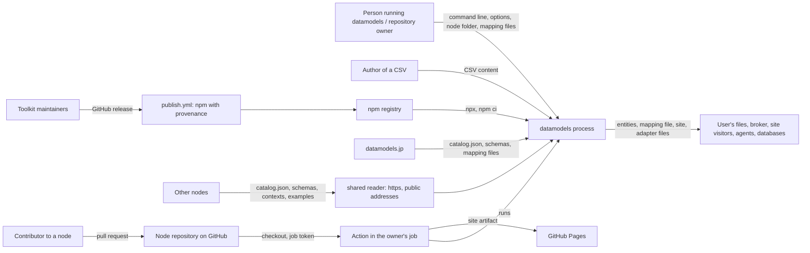

# Threat model — datamodels-toolkit

## 1.1 Header

- **Project**: datamodels-toolkit (geolonia/datamodels-toolkit): the
  `datamodels` command line, published on npm as `@geolonia/datamodels`, its
  library exports (`./build`, `./ngsi`, `./adapters`), the GitHub Action
  "Data model node (datamodels.jp)" in `action.yml`, and the agent skill in
  `skills/datamodels/`.
- **Repository**: https://github.com/geolonia/datamodels-toolkit
- **Version binding**: commit `4d88e4e57fa5225f5069ce481ec0ccc45d1f69bd` on
  `main` (2026-10-15). It is release `v0.3.16` (tag on commit `9441033`) plus
  one commit that only changes the version `init` pins and the README. A report
  against another release is triaged against the model as it stood at that
  release, not against this model.
- **Date / author**: drafted 2026-10-16; ratified by the maintainer, Daniel
  Kastl, on 2026-10-17, who accepted every proposed answer of the 24 questions
  of the first draft in one batch.
- **Generation metadata**: produced with AI assistance. Model/agent: Claude
  Opus 5.5 (`claude-opus-5-5`) in Claude Code; effort: session default.
  Skills used: the Alpha-Omega `threat-model` plugin, version 1.2.1 at commit
  `192fd60cd0afe8851128ce4c68ed68c174c11948` (orchestrator plus
  `threat-model-recon`, `threat-model-surface`, `threat-model-interview` in
  draft-first mode, `threat-model-authoring`, `threat-model-backtest`,
  `threat-model-sidecar`). No MCP servers were used. The maintainer's answers
  were applied on 2026-10-17 by the same process. Questions were adapted
  from the two earlier Geolonia pilots (the first pilot, a small Cloudflare
  Workers service, and the datamodels.jp catalogue); the others were written for a command line and an Action.
- **Reporting cross-reference**: a finding that violates a §1.11 claimed
  property is reported through GitHub's private vulnerability reporting for
  this repository, which is enabled, as [`SECURITY.md`](SECURITY.md) asks. A finding that lands in §1.3 or §1.12
  is closed citing this document.
- **Status**: accepted, 2026-10-17. Every claim is **documented** or
  **maintainer**; no **inferred** or **assumption** claim remains, and §1.18
  has no open question. Closure constraint: an **inferred** claim may escalate
  a report but never close it, and an **assumption** closes only what the
  triage policy below permits; a later revision that adds either kind returns
  the model to review.
- **Triage policy**: `strict`. An **assumption** escalates and never closes.
  See §1.17.
- **Provenance legend**: *(documented, source)* = stated in the named public
  source: a file of this repository (often a source-file comment), or the
  toolkit's documentation at datamodels.jp/en/toolkit, which the maintainer
  writes in geolonia/datamodels; *(maintainer, YYYY-MM)* = confirmed by the
  maintainer in answer to this process; *(assumption, QN)* = a conservative
  default the author applies now, to be ratified by question `QN` in §1.18;
  *(inferred, QN)* = reasoned from code or configuration without a committed
  default, open as question `QN` in §1.18.
- **Glossary**: a short plain-language glossary is at the end of this document
  (Appendix A).
- **Confidence**: 194 documented / 97 maintainer / 0 inferred / 0 assumption.
  Counted as the plugin's validator counts, over §1.2 to §1.19: one count per
  parenthesised tag, by its first kind; the tags in this header and its legend
  are not counted.
- **Backtest note**: a 29-item corpus in 23 clusters, 9 real historical
  items and 20 synthesized. The real items are the fixed defects in
  `CHANGELOG.md` ("Security" and "Fixed" of 0.3.15 and 0.3.16) and issue #93;
  there are no advisories and no issues labelled security. The cases cover all
  eight in-scope families. Re-run on 2026-10-17 after the maintainer's answers,
  for every case whose route depended on an answered question. Dispositions:
  14 `VALID`, 4 `KNOWN-NON-FINDING` (closed), 7 `BY-DESIGN:
  property-disclaimed` (closed), 2 `OUT-OF-MODEL: trusted-input` (closed), 1
  `OUT-OF-MODEL: adversary-not-in-scope` (closed), 1 `OUT-OF-MODEL:
  dependency-contract` (closed), 0 `MODEL-GAP`, 0 `VALID-HARDENING`. The two
  former `MODEL-GAP`s now route `VALID` against the two new claims
  (`P-NODE-FILES-ARE-DATA`, `P-CSV-TEXT-NO-NEW-LINES`); the eleven escalated
  closes now close. Fail-safe figure: 0 of 9 historically-fixed items route to
  a closing disposition; all 9 route `VALID`. 15 of 29 close outright, each
  licensed by a **documented** or **maintainer** claim. No contradictions with
  a historical call. The routing table is producer-side
  (`.threat-model/backtest.md`, ignored by git), as the skill asks; the figures
  here are the only published part.
- **Sibling models**: the datamodels.jp catalogue (geolonia/datamodels) has
  its own model, `threat-model.md` in that repository (geolonia/datamodels#290,
  draft). It covers the published catalogue, its IRI Worker, its MCP server and
  its build; it uses this toolkit's `check` as a dependency. This model does
  not model the catalogue. It treats the catalogue's files as one data source
  among others (§1.7, §1.9).

datamodels-toolkit is a command line and a GitHub Action for data models in
the style of datamodels.jp. People use it to turn a CSV list into NGSI-LD
entities, to start and maintain a *node* (a site of their own that publishes
JSON Schemas, JSON-LD `@context` files and vocabularies at fixed URLs), to
find models on other nodes, and to export a model for other tools (a CSV
template, a Table Schema, a JSON Schema for AI output, a PostgreSQL table).
It runs on the user's machine or in the user's GitHub Actions job, with the
user's rights. It has no server, stores nothing of its own and holds no
credential except the job token the Action is given.

> **Triager quick-start.** Given an inbound finding:
> 0. Read the triage policy above (`strict`). It decides what an
>    **assumption** may do in step 8.
> 1. Locate the sink → look up its row in the §1.7 input-trust table (or the
>    §1.8 output statement, for "downstream may assume X" findings).
> 2. Locate the contract dimension → for numeric domain and representational
>    limits, failure/exception atomicity, recursive or cyclic topology,
>    callback/collaborator execution, serialization/reconstruction,
>    reference/object lifecycle, concurrency/reentrancy, resource complexity,
>    or the project-specific `x-outbound-requests`, `x-version-immutability`
>    and `x-agent-instructions` dimensions, follow the component's row in the
>    §1.7 matrix to its owning claim.
> 3. Check the required attacker capability and control kind against
>    §1.7/§1.10; distinguish the content of a file from its size, a URL the
>    toolkit will read, a file of configuration the user chose, and text meant
>    for people or agents.
> 4. Check the affected component against §1.2/§1.3, and any required option
>    or setting against §1.6.
> 5. If the root cause is in a dependency (Node.js, `ajv`, `jsonld`, `yaml`,
>    Eleventy, `git`, `gh`, GitHub, npm), apply §1.9.
> 6. Apply §1.17's precedence order, beginning with an exact §1.15 match.
> 7. Assign exactly one §1.17 disposition, citing the licensing section and its
>    provenance. If none fits, assign `MODEL-GAP` and trigger §1.16; do not
>    improvise.
> 8. **Before closing, check the provenance of the claim that licenses the
>    close.** This gate applies to every `OUT-OF-MODEL: *`, `BY-DESIGN: *` and
>    `KNOWN-NON-FINDING` route; `VALID` and `MODEL-GAP` are unaffected.
>    - **documented** or **maintainer** → close.
>    - **inferred** → **escalate, never close**, under either policy.
>    - **assumption** → escalate under `strict` (this model). Under `relaxed`
>      it licenses only a **provisional** close for `trusted-input`,
>      `adversary-not-in-scope`, `unsupported-component`,
>      `non-default-build` or a non-security-critical `property-disclaimed`.
>    - An **assumption** never closes `KNOWN-NON-FINDING`, a
>      security-critical `property-disclaimed` or `dependency-contract`.
>    - A disclaimer that rests on the **absence** of a statement never closes a
>      security-critical report, whatever its tag. §1.12 marks the basis of
>      each disclaimer.
>    Record the outcome as `closed`, `provisional` or `escalated` (§1.17). An
>    escalated finding keeps its disposition; it is not a `MODEL-GAP`.

## 1.2 Scope and intended use

The toolkit is used in four ways:

- **Converting a list.** `datamodels mapping` writes a first mapping file for a
  CSV; `datamodels convert` turns the CSV into entities of a catalogue model
  and validates every entity against the model's JSON Schema *(documented, bin/datamodels.mjs header comment: "validates every entity against the model's schema")*.
- **Running a node.** `init`, `add`, `extend`, `check`, `build`, `release`,
  `bump` and `upgrade` start and maintain a node: `node.yaml` and `models/` in a
  repository, built into a static site *(documented, README "Commands" table)*.
- **Publishing a node with the Action.** On a pull request the Action checks
  and builds the node; on `main` it builds the site and deploys it to GitHub
  Pages *(documented, README "GitHub Action": "On every pull request it checks the models")*.
- **Reading other nodes.** `search` and `nodes` read datamodels.jp's
  `catalog.json` and the nodes it links to; `export` and `extend` read a model
  of another node *(documented, README "Commands" table)*.

The library exports are the same code for programs: datamodels.jp builds its
files with `./build`, and `./ngsi` "also runs in a browser or a Cloudflare
Worker" *(documented, README "Build library")*.

### Roles

- **Person running the command line (integrator).** Runs `datamodels` on their
  own machine, on files they chose, with their own rights. Trusted for the
  command line, the options, the node folder and any mapping file they pass
  *(maintainer, 2026-10)*.
- **Repository owner using the Action (integrator).** Writes the workflow
  (usually the one `init` writes), grants the job its permissions, and decides
  what is merged into `main` *(documented, README "The workflow")*. Trusted.
- **Author of an input file.** Whoever wrote the CSV list being converted: a
  municipality's open-data list, a list someone sent. Untrusted for the
  content *(maintainer, 2026-10)*.
- **Contributor to a node.** Anyone who sends a pull request to a node's
  repository. Untrusted until the owner merges *(maintainer, 2026-10)*.
- **Operator of another node.** Whoever runs a site the toolkit reads:
  another node's `catalog.json`, schemas, contexts and examples. Untrusted
  *(documented, src/discover.mjs `plain` comment: "Text from another site, for a terminal")*.
- **Toolkit maintainers.** Merge changes and publish releases. Trusted
  *(documented, README "Releases": "Publishing the GitHub release is the only gate")*.

### Component families

| Family | Representative entry point | Touches outside the process | In this model |
| --- | --- | --- | --- |
| `convert` | `datamodels convert <subject>/<Type> <mapping> <file.csv>`, `datamodels mapping` (`bin/datamodels.mjs`, `src/convert.mjs`, `src/mapping.mjs`, `src/catalog.mjs`) | filesystem (the CSV, mapping files, `--out`); network (catalogue files from `--site`, default datamodels.jp) | in |
| `node-tools` | `datamodels check`, `build`, `add`, `release`, `bump`, `upgrade` (`src/build/*.mjs`, `src/add.mjs`, `src/release.mjs`, `src/version.mjs`) | filesystem (the node folder, `_site/` or `--out`, a temporary folder); child process `git` (`--base`); network (the node's own site, other nodes, GitHub's API for `upgrade`) | in |
| `remote-reads` | the reader of other nodes, `getter` in `src/adapters/index.mjs` with `publicFetch` in `src/adapters/net.mjs`, and the commands built on it: `search`, `nodes`, `export`, `extend` (`src/discover.mjs`, `src/export.mjs`, `src/extend.mjs`) | network; filesystem (`export --out`, `extend` writes into the node) | in |
| `init-github` | `datamodels init [dir] [--github owner/name]` (`src/init.mjs`) | filesystem (the new node); child processes `git` and `gh` with the user's GitHub account | in |
| `action` | `uses: geolonia/datamodels-toolkit@<SHA>` (`action.yml`) | GitHub Actions runner; the job token; `npm ci`; `git fetch`; GitHub Pages | in |
| `library` | `import … from '@geolonia/datamodels/build'`, `/ngsi`, `/adapters` | as the functions called; `./ngsi` has no imports | in |
| `agent-skill` | `skills/datamodels/SKILL.md`, copied by the user into `.claude/skills/` | none itself; it tells an agent which commands to run and which URLs to read | in |
| `release-pipeline` | `.github/workflows/publish.yml`, the `v*.*.*` tags, the npm package, the pull-request checks in `.github/workflows/test.yml` and `.github/workflows/action.yml` | GitHub Actions; npm registry (trusted publishing) | in |
| `dev-tools` | `test/`, `scripts/` (fixtures, changelog), `changes/` | filesystem, network (fixture refresh) | out (§1.3) |
| `toolkit-docs` | the toolkit pages at datamodels.jp/en/toolkit (in geolonia/datamodels) | n/a | out, except where a page states a promise (§1.3) |
| `catalogue` | datamodels.jp and its repository | n/a | out: sibling model (§1.1) |
| `user-nodes` | sites built with the toolkit (models.geolonia.com and others) | n/a | out (§1.3) |

The split follows the principle that a family with its own release cadence and
adversary gets its own document: the catalogue is a separate model
*(maintainer, 2026-10)*.

## 1.3 Out of scope (explicit non-goals)

- **Sandboxing.** The toolkit runs with the rights of the person or job that
  starts it and reads the files it is given. Nothing in a node folder runs as
  code (`P-NODE-FILES-ARE-DATA`), but the toolkit does not isolate a node
  folder, a mapping file or a CSV from the rest of the machine
  (`D-NOT-A-SANDBOX`) *(maintainer, 2026-10)*.
- **Judging truth.** `check` and `convert` check shape: JSON Schema, NGSI-LD
  rules, JSON-LD expansion, the `@context` terms. They do not judge whether a
  value is true, safe to render, lawful to publish or personal data
  (`D-VALIDATION-NOT-TRUTH`) *(documented, datamodels.jp/en/toolkit/check "What check checks")*.
- **A service.** The toolkit runs no server and offers no API. `search` reads
  public indexes; it is not a registry *(documented, src/discover.mjs header: "the nodes reachable from one index, and the models in them")*.
- **The conversion rules themselves.** Mapping files belong to
  geolonia/datamodels; the toolkit applies them *(documented, AGENTS.md "Constraints": "The conversion rules belong to geolonia/datamodels")*.
- **`dev-tools`.** Tests, the fixture scripts and the changelog tooling run
  only on maintainers' machines and in this repository's CI. They are not in
  the npm package (`files` lists `bin`, `src`, `CHANGELOG.md`)
  *(documented, package.json `files`)*. The CI workflows belong to
  `release-pipeline` only as the path code takes into `main`.
- **`toolkit-docs`.** The pages are maintained in geolonia/datamodels. They
  are cited where they state what a command does; a mistake in their prose is
  a documentation bug there *(maintainer, 2026-10)*.
- **`catalogue`.** Modelled separately (§1.1).
- **`user-nodes`.** A site built with the toolkit belongs to its owner, who
  hosts, reviews and merges it. The toolkit's output is in scope (§1.8); the
  owner's hosting, branch rules and domain are not *(maintainer, 2026-10)*.
- **Threats not defended against:** a compromised account of a toolkit
  maintainer, a compromised GitHub or npm, a malicious Node.js, `git` or `gh`,
  and an attacker who already controls the machine or the job that runs the
  toolkit. These hold the keys; the model trusts them (§1.10).

## 1.4 Trust boundaries and data flow

There are five boundaries:

1. **Command-line boundary.** The person running `datamodels` chooses the
   command, the options and the folder. These are trusted. The *content* of a
   CSV is not *(maintainer, 2026-10)*.
2. **Network boundary.** Files of other nodes are read only through the
   shared reader: https, a public host name, an address checked when
   connecting, every redirect checked again *(documented, src/adapters/net.mjs header: "only https, and only to a public address")*.
   Three other reads do not use it: `convert`'s `--site`, the comparison of
   `check` and `release` with the node's own published files, and `upgrade`'s
   read of GitHub's API (§1.7) *(maintainer, 2026-10)*.
3. **Pull-request boundary of a node.** On `pull_request` the Action runs the
   contributor's merge commit with the job's token. GitHub gives a pull
   request from a fork a read-only token and no secrets; the workflow `init`
   writes asks for `contents: read` in that job *(documented, README "The whole workflow that init writes": `permissions: contents: read` in job `check`)*.
4. **Publish boundary of a node.** On `main` the Action builds and deploys
   with `pages: write` and `id-token: write`, which the calling job grants
   *(documented, action.yml header comment: "The calling job needs `pages: write` and `id-token: write` to deploy")*.
5. **Release boundary of the toolkit.** A published GitHub release whose tag
   is `v` plus the package version starts `publish.yml`; npm accepts the job's
   OIDC token and adds provenance *(documented, .github/workflows/publish.yml header comment: "npm adds provenance (the commit and the workflow that built")*.

Reachability preconditions:

| Family | A finding matters only if |
| --- | --- |
| `convert` | it is reachable from the bytes of a CSV the user converts, with a mapping file and a site the user chose |
| `node-tools` | it is reachable from the files of a node folder (from a contributor's pull request, or from a node the user did not write), or from what another node or the node's own site answers |
| `remote-reads` | it is reachable from what another node's host answers (content, headers, redirects, DNS) to a read the toolkit makes on its own or for a URL in a node file |
| `init-github` | it is reachable from the options of `init` and the content of the folder it runs in |
| `action` | it is reachable from a node repository's files or a pull request, through the Action's steps, and changes what is deployed or exposes the token |
| `library` | it is reachable through an exported function from the data its caller passes |
| `agent-skill` | it is reachable from text an agent reads while following the skill, and changes what the agent does beyond what the user asked |
| `release-pipeline` | it lets someone without the maintainers' rights change what `npx @geolonia/datamodels@X.Y.Z` or `uses: geolonia/datamodels-toolkit@<SHA>` runs |

## 1.5 Assumptions about the environment

- **Runtime.** Node.js 24 or later *(documented, package.json `engines`)*.
  The command line is an ES module run by `node`; the Action uses
  `actions/setup-node` with Node 24 *(documented, action.yml step "Set up Node")*.
- **Host.** Any machine the user runs it on, or a GitHub-hosted runner for the
  Action *(documented, README "Install")*. No platform is singled out.
- **Terminal.** Prompts only when both standard input and output are a
  terminal; in CI a missing answer is a usage error *(documented, bin/datamodels.mjs header: "In a terminal it asks for what the options do not give")*.
- **Exit codes.** 0 success, 1 a problem, 2 a usage error; the command line
  never calls `process.exit()` *(documented, bin/datamodels.mjs `Exit` comment: "Nothing calls process.exit")*.
- **Concurrency.** One command is one process; nothing is shared between
  runs. `add` takes a lock file in the subject folder against two runs at
  once *(documented, src/add.mjs `addModel`, the lock file written with flag `wx`)*.

### No-surprise side-effects inventory

| Effect | Stance | Components | Conditions | Provenance |
| --- | --- | --- | --- | --- |
| Outbound network through the shared reader | present | `remote-reads`, `node-tools` | `search`, `nodes`, `export`, `extend`; `check` and `build` for other nodes' schemas, contexts and indexes; none with `--offline` | *(documented, src/adapters/index.mjs `getter` comment: "with the global fetch (the default everywhere), it reads through publicFetch")* |
| Outbound network outside the shared reader | present | `convert`, `node-tools` | `convert` and `mapping` read `--site` (default `https://datamodels.jp`) with the global `fetch`; `check` and `release` read the node's own published files under `baseUrl`; `upgrade` reads `https://api.github.com/repos/geolonia/datamodels-toolkit/` | *(maintainer, 2026-10)* |
| Child processes | present | `node-tools`, `init-github`, `action` | `git rev-parse`, `git show`, `git diff` for `check --base`; `gh` and `git` for `init --github`; the Action runs `npm ci` and `git fetch`. Search: `grep -rn "execFile" src bin` — 2 files, `src/build/published.mjs` and `bin/datamodels.mjs` (for `init`) | *(maintainer, 2026-10)* |
| Filesystem writes | present | all command families | only the named outputs: `--out` of `convert` (overwrites), `mapping` (never overwrites), `export` (overwrites files of the same name), `build` into `_site/` or `--out`; `init`, `add`, `extend`, `release`, `bump`, `upgrade` write into the node folder; `check` builds into a temporary folder and removes it | *(maintainer, 2026-10)* |
| Environment variables | absent in the toolkit's code | all | `grep -rn "process.env" src bin` — 0 hits. Dependencies may read their own (Eleventy, Node.js) | *(maintainer, 2026-10)* |
| Code from the node folder | absent, with one named exception | `node-tools` | pages use the toolkit's own templates and its own Eleventy configuration; Eleventy still reads a `.eleventyignore` in the current directory | *(documented, src/build/pages.mjs `writePages` comment: "A .eleventyignore in the current directory is still read")* |
| Writes to the user's GitHub | present | `init-github` | only with `--github`: creates a public repository, pushes the first commit, turns on Pages | *(documented, src/init.mjs `publishToGitHub` comment: "create the public repository `repo`")* |
| Writes to the node repository from the Action | absent | `action` | the Action pushes nothing and calls no GitHub API with the token; it uploads a Pages artifact and deploys it | *(documented, action.yml header comment: "check the node, build its files and pages, and deploy them")* |

## 1.6 Build-time and configuration variants

| Knob | Default | Effect on the model | Support posture | Provenance |
| --- | --- | --- | --- | --- |
| `--offline` on `check`, `release`, `bump`; Action input `offline` | off (`'false'`) | skips the published files, the extended models and the schemas on other sites; voids `P-PUBLISHED-COMPARISON` | supported | *(documented, datamodels.jp/en/toolkit/check: "`--offline` skips the published files, the extended models")* |
| `--base <git ref>` on `check`; set by the Action on a pull request | not set locally; `origin/<base branch>` in the Action on `pull_request` | compares release snapshots with the ref (`P-BASE-COMPARISON`) | supported | *(documented, action.yml comment: "On a pull request, also compare with the base branch")* |
| `prerelease: true` in `node.yaml` | absent | while true at the base ref and in the change, changes and removals of published files are notes; voids `P-BASE-COMPARISON` for that time | supported until a node's launch; once false at the base it cannot become true again | *(documented, datamodels.jp/en/toolkit/versions "Before the launch")* |
| `--all-released` on `check` | off | requires a snapshot of each subject's current version | supported | *(documented, datamodels.jp/en/toolkit/versions: "`--all-released` also requires a snapshot of each subject's current version")* |
| Action input `deploy` | `'true'` | `'false'` only checks and builds; nothing is deployed | supported | *(documented, action.yml input `deploy` description)* |
| `--site <URL or dir>` on `convert`, `mapping` | `https://datamodels.jp` | another site or a local copy of it; `http://` is accepted | supported; the user chooses it (trusted input) | *(maintainer, 2026-10)* |
| `--index <URL>` on `search`, `nodes`, `export`, `extend` | `https://datamodels.jp/catalog.json`, or the index of the node that made a type IRI | where models are read from; always through the shared reader | supported | *(documented, datamodels.jp/en/toolkit/reference `--index` rows)* |
| `fetch` option of the library functions (`getter`, `checkNode`, `buildNode`, `exportModel`, …) | the global `fetch`, which the reader replaces with `publicFetch` | a caller's own `fetch` is used as it is: the address check at connection and the 5 MB cap no longer apply; the URL and redirect checks still do | supported for tests and library callers, who then own the address check | *(maintainer, 2026-10)* |
| `--github owner/name` on `init` | off | creates a public repository and turns on Pages with the user's `gh` account | supported | *(documented, bin/datamodels.mjs header: "With --github owner/name it also creates the repository and turns on Pages")* |
| `--yes` on `init` | off | never asks; a missing answer is a usage error | supported | *(documented, bin/datamodels.mjs `init`: "Questions only in a terminal")* |

## 1.7 Assumptions about inputs

### Per-input-operand trust table

Coverage: every command of the command line with the inputs that come from a
file, the network or a pull request; the Action's three inputs and the
GitHub context it reads; the library's `fetch` option; the agent skill. 43
rows. Not tabled one by one: options that only select or format output
(`--json`, `--limit`, `--rows`, `--normalized`, `--value`, `--subclass`,
`--iris`, `--languages`, `--license`), which are trusted like the command
line, and the individual fields of `catalog.yaml`, `notes.yaml`,
`subject.yaml` (covered by the row for the node folder).

| Entry point | Input operand | Attacker-controllable? | Control kind | Caller must enforce | Provenance |
| --- | --- | --- | --- | --- | --- |
| `convert`, `mapping` | the CSV bytes | **yes**, the file's author | data, size | nothing for shape: UTF-8 or Shift_JIS decoded strictly, RFC 4180 parsed strictly; the user bounds the size (`D-NO-INPUT-LIMITS`) | *(documented, src/convert.mjs `parseCsv` comment: "Throws on what would otherwise shift or merge values silently")* |
| `convert`, `mapping` | CSV header names | **yes** | data | nothing; text from a CSV may not add lines to the generated mapping file (`P-CSV-TEXT-NO-NEW-LINES`, violated at the bound commit); echoed to the terminal as it is (`D-LOCAL-TEXT-ECHOED`) | *(maintainer, 2026-10)* |
| `convert` | cell values | **yes** | data | the user checks the entities; every entity is validated against the schema; values are not escaped for any later use (`D-OUTPUT-TEXT-AS-INPUT`) | *(documented, bin/datamodels.mjs header: "validates every entity against the model's schema")* |
| `convert` | a cell read with the `json` transform | **yes** | data, object-topology | the value is parsed with `JSON.parse` and placed into the entity; the schema decides what is allowed | *(documented, src/convert.mjs `apply` case `json`)* |
| `convert` | the mapping argument: a catalogue mapping name, `csv-template` or a path | no — the user chooses it | resource-name | n/a | *(documented, bin/datamodels.mjs header: "The mapping may also be a file of your own")* |
| `convert`, `mapping` | a mapping file of the user's own and the files its `via` names | no — trusted configuration; `via` may name any `.yaml` file relative to it | resource-name, data | the user writes or reviews the mapping file (`D-NOT-A-SANDBOX`) | *(maintainer, 2026-10)* |
| `convert`, `mapping` | `--site` | no — the user chooses it | resource-name | n/a; a local directory is read only inside it | *(documented, src/catalog.mjs `siteReader` comment: "the file must stay inside the site directory")* |
| `convert`, `mapping` | `catalog.json`, schemas and mapping files read from the site | no — the catalogue is trusted for content (§1.9); only `https://datamodels.jp` URLs are read, by path | data | n/a | *(documented, src/catalog.mjs header: "URLs in the catalog always name https://datamodels.jp")* |
| `convert` | `--set attribute=value` | no — command line | data | n/a | *(documented, bin/datamodels.mjs header: "--set attribute=value (for what the list does not carry")* |
| `convert`, `mapping` | `--out` path | no — command line | resource-name | `convert` overwrites it; `mapping` never does | *(documented, bin/datamodels.mjs `mapping`: "A mapping someone has filled in is work: never write over it")* |
| `check`, `build`, `release`, `bump`, `add` | `node.yaml` | **yes**, a contributor to the node | data, resource-name | the owner reviews it; settings are checked (URLs http(s) without credentials, `nodes` https only) | *(documented, src/build/node.mjs `settingsProblems` and `httpUrl` comment: "Every URL here is published")* |
| `check`, `release` | `baseUrl` in `node.yaml`, as the address of the node's published files | **yes**, a contributor: in the `pull_request` job it is read before anyone merged it | resource-name | the owner reviews it; until then the check job reads under it with the global `fetch` (http and internal hosts allowed, status and error codes printed in notes; §1.6, `D-OWN-SITE-READS`) | *(maintainer, 2026-10)* |
| `check`, `build` | `models/<subject>/context.jsonld` | **yes**, a contributor | data, resource-name | review; imports by URL only from the node's own or a listed node's `/context/` | *(documented, src/build/load.mjs import check: "only catalog contexts may be imported by URL")* |
| `check`, `build` | `models/<subject>/<Type>/schema.json` | **yes** | data, size, resource-name (`$ref`) | review; compiled by Ajv in `check` (`D-SCHEMA-COMPILE-COST`); `$ref` to another site read only through the shared reader | *(maintainer, 2026-10)* |
| `check`, `build` | examples (`example.json`, `example-normalized.jsonld`) | **yes** | data | review; validated, expanded and compacted; an example's own `@context` URL is read through the shared reader | *(documented, datamodels.jp/en/toolkit/check "What check checks")* |
| `check`, `build` | `catalog.yaml`, `notes.yaml`, `subject.yaml`, mapping tables, `ADOPTERS.yaml`, `extensions/*.yaml` | **yes** | data, x-agent-text | review of wording; escaped on pages (`P-PAGES-ESCAPED`); unfiltered in `llms.txt`, `catalog.json` and the AI adapter (`D-AGENT-TEXT`) | *(documented, src/build/pages.mjs `setNunjucksEnvironmentOptions({ autoescape: true` )* |
| `check`, `build` | `extends[].index` in `catalog.yaml` | **yes** | resource-name | must be https; read through the shared reader | *(documented, src/build/node.mjs `loadNode` comment: "extends goes into catalog.json as written, so it is checked here")* |
| `check`, `build` | the folder and file names under `models/` | **yes** | resource-name | names become URL paths and file names of the site; subject and type names are checked by the model rules | *(maintainer, 2026-10)* |
| `check --base` | the git ref | no — command line (the Action passes `origin/<base>`) | resource-name | n/a | *(documented, src/build/published.mjs `compareWithBase` comment)* |
| `check --base` | `node.yaml` and the release snapshots at the ref | no — the base branch, already merged | data | n/a | *(documented, src/build/published.mjs header: "this compares the snapshots with a git ref")* |
| `check`, `release` | the node's published files, as its site answers | **yes**, whoever controls the site or its DNS; normally the owner | data, size | n/a; compared byte for byte; no size cap | *(maintainer, 2026-10)* |
| `upgrade` | GitHub API answers for the latest or named release and its commit | no — GitHub is trusted (§1.9) | data | n/a; tag must be `vX.Y.Z`, SHA 40 hex digits | *(documented, src/version.mjs `upgradeNode`: "A release, not only a tag or branch of that name")* |
| `upgrade` | the node's workflow and Markdown files | no — the owner's | data | n/a; only the `uses:` line of this Action and `npx` lines change | *(documented, src/version.mjs `upgradeNode` comment)* |
| `search`, `nodes` | `--index` and `--depth` | no — command line | resource-name, size | n/a; depth 0 to 5 | *(documented, src/discover.mjs `MAX_DEPTH` comment: "a large network cannot keep the command busy")* |
| `search`, `nodes` | each linked node's `catalog.json` (`nodes`, `extends`, models, titles) | **yes**, the other node's operator | data, size, resource-name | nothing; read through the shared reader; at most 50 nodes; text printed as plain text | *(documented, src/discover.mjs header: "Every read goes through the adapters' getter")* |
| `export`, `extend` | the model argument (`subject/Type` or a type IRI) | no — command line | resource-name | n/a; a type IRI selects the index of the node that made it | *(documented, src/discover.mjs `indexForModel` comment)* |
| `export`, `extend` | the other node's catalog entry (type, version, URLs, texts) | **yes** | data, resource-name | nothing; type must be UpperCamelCase and version `x.y.z`; schema and example only under that node's `schema/` and `examples/` | *(documented, CHANGELOG.md 0.3.15 "Security": "so a catalog cannot add lines to the files they write")* |
| `extend` | the other node's schema and example | **yes** | data, size | the owner reviews what `extend` copied before committing (`D-REMOTE-CONTENT-UNREVIEWED`) | *(maintainer, 2026-10)* |
| all reads of other nodes | HTTP status, headers, redirects, body size, timing | **yes** | data, size, rate | nothing; at most 5 redirects, each checked; 5 MB; one deadline per read | *(documented, src/adapters/index.mjs `getter` comment: "One deadline for the read")* |
| all reads of other nodes | DNS answers for the other node's host | **yes** | resource-name | nothing; every address must be public, checked at connection | *(documented, src/adapters/net.mjs `publicLookup` comment: "dns.lookup that refuses a host with any non-public address")* |
| `check` (JSON-LD) | remote `@context` documents named by examples and contexts | **yes** | data, size | nothing; read through the shared reader; an unread one is a note | *(documented, src/build/examples.mjs `contextLoader`)* |
| `check` (Ajv) | remote schemas named by `$ref` | **yes**, if a node file names them | data, size | the owner chooses which `$ref`s to write; compiled by Ajv (`D-SCHEMA-COMPILE-COST`) | *(maintainer, 2026-10)* |
| `export` | `--to`, `--out` | no — command line | resource-name | `--out` files of the same name are overwritten | *(documented, src/export.mjs `writeExport` comment: "over files of the same name")* |
| `init` | options and answers (`--base-url`, publisher, licence, subject, `--github`) | no — command line or terminal | data | n/a; checked before anything is written | *(documented, bin/datamodels.mjs `init`: "init: nothing written")* |
| `init` | the existing content of the target folder | no — the user's | data | n/a; never overwritten; with `--github`, other files stop it | *(documented, src/init.mjs `writeNode` comment: "never over an existing file")* |
| `init --github` | the `gh` account | no — the user's | collaborator-implementation | n/a | *(documented, src/init.mjs `publishToGitHub` comment: "Put the node on GitHub with the gh CLI")* |
| Action | input `directory` | no — the owner's workflow | resource-name | n/a; passed in the environment | *(documented, action.yml header comment: "Inputs reach the shell only through environment variables")* |
| Action | inputs `deploy`, `offline` | no — the owner's workflow | data | n/a | *(documented, action.yml header comment)* |
| Action | `github.base_ref` | **yes** in principle, the base branch name of a pull request, chosen among existing branches | resource-name | n/a; passed in the environment, used inside a refspec | *(documented, action.yml step "Check", env `BASE_REF`)* |
| Action | the checked-out node repository (on a pull request, the merge commit) | **yes**, a contributor | data, callback-code | the owner's workflow decides what runs; on `pull_request` the contributor's workflow file runs as well (§1.10) | *(maintainer, 2026-10)* |
| Action | `github.token` | no — GitHub | collaborator-implementation | the owner grants the job only what it needs | *(documented, action.yml comment: "the token is passed to this one fetch in the environment")* |
| library | the `fetch` option | no — the calling program | collaborator-implementation | the caller does the address check its own `fetch` skips (§1.6) | *(maintainer, 2026-10)* |
| `agent-skill` | text the agent reads while following it (`llms.txt`, `catalog.json`, MCP answers, CSV content) | **yes**, the authors of that text | x-agent-text | the user and the agent's own controls (`D-AGENT-TEXT`) | *(maintainer, 2026-10)* |

### Size, shape and rate

- **Local files.** No size, row, column, nesting or count limit on CSV, YAML,
  JSON, schemas or contexts; a CSV is read whole into memory
  *(maintainer, 2026-10)*. JSON is parsed with `JSON.parse`, YAML with `yaml` 2.x
  defaults *(maintainer, 2026-10)*.
- **Other nodes.** 5 MB per response, at most 5 redirects, one deadline per
  read: 15 seconds in `search` and `nodes`; 20 seconds in `check`, `build`,
  `export` and `extend`; 5 seconds for the guess at a type IRI's own index. At
  most depth 5 and 50 nodes for `search` and `nodes` *(documented, src/adapters/net.mjs `MAX_BYTES`; src/discover.mjs `MAX_DEPTH`, `MAX_NODES`, `OWN_INDEX_TIMEOUT` and the `timeout` default of `discoverNodes`)*.
- **The node's own site** (`check`, `release`): 20 seconds per file, no size
  cap *(maintainer, 2026-10)*.
- **`--site`** (`convert`): no deadline and no size cap *(maintainer, 2026-10)*.

### Contract-dimension matrix

Status is `claimed`, `disclaimed`, `N/A — reason` or `unresolved`. Three
project-specific dimensions: `x-outbound-requests` (which URLs the toolkit
reads, and from where), `x-version-immutability` (whether a published version
of a node keeps its bytes) and `x-agent-instructions` (text that an AI agent
may read as instructions).

| Component | Dimension | Status | Conditions / boundary | Routes to | Provenance |
| --- | --- | --- | --- | --- | --- |
| `convert` | numeric domain and representational limits | claimed | numbers must be finite, whole numbers whole, municipality codes checked (check digit); invalid values are reported, not guessed | §1.11 `P-ROWS-VALIDATED` | *(documented, src/convert.mjs `code6` and `apply` cases `number`, `integer`)* |
| `convert` | failure and exception atomicity | claimed | an invalid row is reported and the exit code is 1; with `--check` nothing is written; a parse error stops before output | §1.11 `P-CSV-STRICT`, `P-ROWS-VALIDATED` | *(documented, bin/datamodels.mjs header: "the exit code is 1 when a row is invalid")* |
| `convert` | recursive or cyclic topology | claimed | `via` chains between mapping files are followed once each; a cycle is reported | §1.11 `P-ROWS-VALIDATED` | *(documented, src/catalog.mjs `loadTarget` comment: "the converter reports a cycle")* |
| `convert` | callback and collaborator execution | N/A — mapping files are data; transforms are a fixed list in the code | | §1.7 | *(documented, src/convert.mjs `TRANSFORMS`)* |
| `convert` | serialization and reconstruction | claimed | a `__proto__` column or attribute stays data in the NGSI-LD helpers | §1.11 `P-NGSI-PROTO-AS-DATA` | *(documented, src/ngsi.mjs `setOwn` comment: "would change the object's prototype and drop the attribute")* |
| `convert` | reference and object lifecycle | N/A — one run, no objects outlive it | | §1.5 | *(documented, bin/datamodels.mjs header)* |
| `convert` | concurrency and reentrancy | N/A — one process per command | | §1.5 | *(documented, bin/datamodels.mjs header)* |
| `convert` | resource complexity | disclaimed | no limit on file size, rows or columns; the whole CSV is in memory | §1.12 `D-NO-INPUT-LIMITS` | *(maintainer, 2026-10)* |
| `convert` | x-outbound-requests | disclaimed | `--site` is read with the global `fetch`: redirects followed, no address check, no deadline | §1.12 `D-OWN-SITE-READS` | *(maintainer, 2026-10)* |
| `convert` | x-agent-instructions | claimed | text from a CSV never adds lines to the mapping file `mapping` writes; violated at the bound commit by unused header names, a `VALID` finding | §1.11 `P-CSV-TEXT-NO-NEW-LINES` | *(maintainer, 2026-10)* |
| `node-tools` | numeric domain and representational limits | claimed | versions `X.Y.Z`; URLs in `node.yaml` http(s) without credentials; other nodes https | §1.11 `P-CONTEXT-IMPORTS-LISTED` | *(documented, src/build/node.mjs `settingsProblems`)* |
| `node-tools` | failure and exception atomicity | claimed | `check` collects every problem and exits 1; the build stops before writing a released version whose sources changed; `add` stages files and renames them | §1.11 `P-PUBLISHED-COMPARISON` | *(documented, src/build/check.mjs header and src/release.mjs `releaseSubject`: "throws on a problem")* |
| `node-tools` | recursive or cyclic topology | claimed | a context that imports itself is an error; mapping `via` cycles are problems | §1.11 `P-CONTEXT-IMPORTS-LISTED` | *(documented, src/build/check.mjs `resolveContext` comment: "only an import of itself is refused")* |
| `node-tools` | callback and collaborator execution | claimed | node files are read as data; pages use the toolkit's own templates and Eleventy configuration; a `.eleventyignore` in the current directory is the one file Eleventy reads | §1.11 `P-NODE-FILES-ARE-DATA` | *(maintainer, 2026-10)* |
| `node-tools` | serialization and reconstruction | disclaimed | schemas are compiled by Ajv, which treats a schema like code; `pattern` becomes a regular expression | §1.12 `D-SCHEMA-COMPILE-COST` | *(maintainer, 2026-10)* |
| `node-tools` | reference and object lifecycle | claimed | a released version keeps a snapshot; a published version without one is noted | §1.11 `P-PUBLISHED-COMPARISON` | *(documented, datamodels.jp/en/toolkit/versions "How a published version is kept")* |
| `node-tools` | concurrency and reentrancy | claimed | `add` refuses a second run on the same subject while the lock file exists | §1.11 `P-PUBLISHED-COMPARISON` | *(documented, src/add.mjs lock file)* |
| `node-tools` | resource complexity | disclaimed | no limit on node files; reads of other nodes bounded as in `remote-reads` | §1.12 `D-NO-INPUT-LIMITS` | *(maintainer, 2026-10)* |
| `node-tools` | x-outbound-requests | disclaimed | the node's own published files are read under `baseUrl` with the global `fetch` | §1.12 `D-OWN-SITE-READS` | *(maintainer, 2026-10)* |
| `node-tools` | x-version-immutability | claimed | `check --base` fails on a changed or removed snapshot file, except during the pre-release | §1.11 `P-BASE-COMPARISON`; §1.12 `D-PRERELEASE-CORRECTIONS` | *(documented, src/build/published.mjs header)* |
| `node-tools` | x-agent-instructions | disclaimed | model text goes unfiltered into `llms.txt`, `catalog.json` and the AI adapter's schema descriptions | §1.12 `D-AGENT-TEXT` | *(maintainer, 2026-10)* |
| `remote-reads` | numeric domain and representational limits | claimed | IPv4 and IPv6 addresses classified, IPv4 inside IPv6 included; non-public ranges refused | §1.11 `P-PUBLIC-READS` | *(documented, src/adapters/net.mjs `isPublicAddress` comment)* |
| `remote-reads` | failure and exception atomicity | disclaimed | a node that cannot be read is a note, never a failure of someone else's command (except the starting index of `search`) | §1.12 `D-OTHER-NODES-NOTED` | *(documented, src/discover.mjs header: "A node that cannot be read is a note, never a failure")* |
| `remote-reads` | recursive or cyclic topology | claimed | each index is read once, so a cycle of `nodes` links ends; depth at most 5 | §1.11 `P-REMOTE-READS-BOUNDED` | *(documented, src/discover.mjs header: "Each index is read once, so a cycle ends")* |
| `remote-reads` | callback and collaborator execution | N/A — answers are parsed as JSON only | | §1.7 | *(documented, src/adapters/index.mjs `getter`: `res.json()`)* |
| `remote-reads` | serialization and reconstruction | claimed | a remote type name and version are used in file names, YAML and messages only when they match `^[A-Z][A-Za-z0-9]*$` and `x.y.z` | §1.11 `P-REMOTE-NAMES-CHECKED` | *(documented, src/discover.mjs `TYPE_NAME` comment: "before its type and version are used in file names")* |
| `remote-reads` | reference and object lifecycle | N/A — each command reads afresh; caches live for one run | | §1.5 | *(documented, src/adapters/index.mjs `getter`: "A reader of JSON URLs that reads each once")* |
| `remote-reads` | concurrency and reentrancy | N/A — reads within one command | | §1.5 | *(documented, src/discover.mjs header)* |
| `remote-reads` | resource complexity | claimed | 5 MB per response, one deadline per read, 50 nodes | §1.11 `P-REMOTE-READS-BOUNDED` | *(documented, src/adapters/net.mjs `MAX_BYTES`)* |
| `remote-reads` | x-outbound-requests | claimed | https only, public host names, addresses checked at connection, redirects checked again, reads limited to a node's `schema/` or `examples/` stay there | §1.11 `P-PUBLIC-READS` | *(documented, CHANGELOG.md 0.3.15 "Security")* |
| `remote-reads` | x-agent-instructions | claimed | text from other nodes printed by `search` and `nodes` has no control characters or direction overrides, on one line | §1.11 `P-TERMINAL-TEXT-PLAIN` | *(documented, src/discover.mjs `plain` comment: "an escape sequence could rewrite the screen")* |
| `init-github` | numeric domain and representational limits | claimed | `--github` must be `owner/name` of letters, digits and `._-` | §1.11 `P-INIT-ONLY-ITS-FILES` | *(documented, src/init.mjs `REPO_NAME`)* |
| `init-github` | failure and exception atomicity | claimed | settings are checked before anything is written; with `--github`, other files or changes in the working tree stop it before a commit; the earlier history of an existing repository is pushed as it is (`D-INIT-PUSHES-HISTORY`) | §1.11 `P-INIT-ONLY-ITS-FILES` | *(documented, src/init.mjs `publishToGitHub` comment: "anything else in the folder stops it, so nothing else is published")* |
| `init-github` | recursive or cyclic topology | N/A — no recursive input | | §1.7 | *(documented, src/init.mjs `nodeFiles`)* |
| `init-github` | callback and collaborator execution | claimed | `gh` and `git` are run without a shell, with arguments as a list | §1.11 `P-INIT-ONLY-ITS-FILES` | *(documented, src/init.mjs `publishToGitHub` comment: "runs a command without a shell")* |
| `init-github` | serialization and reconstruction | N/A — writes fixed templates with the user's answers | | §1.7 | *(documented, src/init.mjs `nodeFiles`)* |
| `init-github` | reference and object lifecycle | N/A — one run | | §1.5 | *(documented, src/init.mjs `writeNode`)* |
| `init-github` | concurrency and reentrancy | N/A — one process | | §1.5 | *(documented, src/init.mjs `writeNode`)* |
| `init-github` | resource complexity | N/A — a fixed set of files | | §1.5 | *(documented, src/init.mjs `nodeFiles`)* |
| `action` | numeric domain and representational limits | N/A — three string inputs | | §1.7 | *(documented, action.yml `inputs`)* |
| `action` | failure and exception atomicity | claimed | a problem in `check` fails the step; build and deploy do not run after it | §1.11 `P-BASE-COMPARISON` | *(documented, action.yml steps "Check", "Build", "Deploy to GitHub Pages")* |
| `action` | recursive or cyclic topology | N/A — no recursive input | | §1.7 | *(documented, action.yml `runs`)* |
| `action` | callback and collaborator execution | claimed | inputs reach the shell only through environment variables; the token only for one `git fetch` | §1.11 `P-ACTION-INPUTS-AS-DATA`, `P-ACTION-TOKEN-USE` | *(documented, action.yml header comment)* |
| `action` | serialization and reconstruction | N/A — no serialized state | | §1.7 | *(documented, action.yml `runs`)* |
| `action` | reference and object lifecycle | disclaimed | the token is in the environment of the whole "Check" step, so the toolkit process and its dependencies run with it | §1.12 `D-TOKEN-IN-STEP-ENV` | *(maintainer, 2026-10)* |
| `action` | concurrency and reentrancy | N/A — the caller's `concurrency` group serialises Pages deploys | | §1.13 | *(documented, README "The whole workflow that init writes": `concurrency: group: pages`)* |
| `action` | resource complexity | N/A — the caller's `timeout-minutes` bounds the job | | §1.13 | *(documented, README "The whole workflow that init writes": `timeout-minutes: 10`)* |
| `action` | x-outbound-requests | claimed | `npm ci` from the lockfile with `--ignore-scripts`; one `git fetch` of the base branch; the toolkit's own reads as in `node-tools` | §1.11 `P-INSTALL-NO-SCRIPTS` | *(documented, action.yml step "Install the toolkit")* |
| `action` | x-version-immutability | claimed | on a pull request the snapshots are compared with the base branch | §1.11 `P-BASE-COMPARISON` | *(documented, action.yml comment: "a published version is never changed or removed")* |
| `library` | numeric domain and representational limits | claimed | the same checks as the commands; `ngsi` checks attribute types and polygon rings | §1.11 `P-NGSI-PROTO-AS-DATA` | *(documented, README "Build library")* |
| `library` | failure and exception atomicity | claimed | `readRefs` returns problems instead of throwing, so the caller decides | §1.11 `P-PUBLIC-READS` | *(documented, src/adapters/index.mjs `readRefs` comment: "a schema that cannot be read is a problem, not an error")* |
| `library` | recursive or cyclic topology | disclaimed | `toNormalized` and `toKeyValues` walk the data the caller passes; no depth limit | §1.12 `D-NO-INPUT-LIMITS` | *(maintainer, 2026-10)* |
| `library` | callback and collaborator execution | disclaimed | a caller's own `fetch` replaces `publicFetch` and is trusted | §1.12 `D-CALLER-FETCH` | *(maintainer, 2026-10)* |
| `library` | serialization and reconstruction | claimed | `__proto__` keys stay own properties | §1.11 `P-NGSI-PROTO-AS-DATA` | *(documented, CHANGELOG.md 0.3.16 "Fixed")* |
| `library` | reference and object lifecycle | N/A — pure functions return new objects | | §1.8 | *(documented, src/ngsi.mjs header)* |
| `library` | concurrency and reentrancy | N/A — no shared mutable state | | §1.5 | *(documented, README "Build library": "It has no imports")* |
| `library` | resource complexity | disclaimed | no limit on the data the caller passes | §1.12 `D-NO-INPUT-LIMITS` | *(maintainer, 2026-10)* |
| `agent-skill` | numeric domain and representational limits | N/A — instructions, no input | | §1.7 | *(documented, skills/datamodels/SKILL.md)* |
| `agent-skill` | failure and exception atomicity | N/A — instructions | | §1.7 | *(documented, skills/datamodels/SKILL.md)* |
| `agent-skill` | recursive or cyclic topology | N/A — instructions | | §1.7 | *(documented, skills/datamodels/SKILL.md)* |
| `agent-skill` | callback and collaborator execution | disclaimed | the agent runs the commands the skill names with the user's rights; the skill does not limit it | §1.12 `D-SKILL-GUIDANCE-ONLY` | *(maintainer, 2026-10)* |
| `agent-skill` | serialization and reconstruction | N/A — instructions | | §1.7 | *(documented, skills/datamodels/SKILL.md)* |
| `agent-skill` | reference and object lifecycle | N/A — copied once by the user; not updated by the package | | §1.13 | *(documented, README "Agent skill": "It is not in the npm package")* |
| `agent-skill` | concurrency and reentrancy | N/A — instructions | | §1.7 | *(documented, skills/datamodels/SKILL.md)* |
| `agent-skill` | resource complexity | N/A — instructions | | §1.7 | *(documented, skills/datamodels/SKILL.md)* |
| `agent-skill` | x-agent-instructions | disclaimed | the skill sends agents to read `llms.txt`, `catalog.json` and MCP answers; nothing filters instructions in them | §1.12 `D-AGENT-TEXT` | *(maintainer, 2026-10)* |
| `release-pipeline` | numeric domain and representational limits | claimed | the release tag must be `v` plus the version in `package.json` | §1.11 `P-RELEASE-GATED` | *(documented, .github/workflows/publish.yml step "The tag is the package version")* |
| `release-pipeline` | failure and exception atomicity | claimed | the tests run before `npm publish`; a failure publishes nothing; a GitHub pre-release publishes nothing | §1.11 `P-RELEASE-GATED` | *(documented, .github/workflows/publish.yml header: "only after the tests pass. A pre-release publishes nothing")* |
| `release-pipeline` | recursive or cyclic topology | N/A — no recursive input | | §1.7 | *(documented, .github/workflows/publish.yml)* |
| `release-pipeline` | callback and collaborator execution | claimed | no dependency runs install scripts while the job can get an OIDC token | §1.11 `P-INSTALL-NO-SCRIPTS` | *(documented, .github/workflows/publish.yml comment: "no dependency runs code while this job can get an")* |
| `release-pipeline` | serialization and reconstruction | disclaimed | the package pins its direct dependencies exactly but ships no lockfile; `npx` resolves the rest at install time | §1.12 `D-NO-SHRINKWRAP` | *(maintainer, 2026-10)* |
| `release-pipeline` | reference and object lifecycle | claimed | `v*.*.*` tags cannot be moved or deleted (organisation ruleset, bypass for the operations team); `init` pins the Action by commit SHA | §1.11 `P-RELEASE-GATED` | *(maintainer, 2026-10)* |
| `release-pipeline` | concurrency and reentrancy | N/A — one publish per release event | | §1.9 | *(documented, .github/workflows/publish.yml `on: release`)* |
| `release-pipeline` | resource complexity | N/A — runner time limit of 10 minutes | | §1.9 | *(documented, .github/workflows/publish.yml `timeout-minutes: 10`)* |

## 1.8 Assumptions and guarantees about outputs

| Output channel | Component | Taint | Downstream must not assume | Provenance |
| --- | --- | --- | --- | --- |
| Entities from `convert` (standard output or `--out`) | `convert` | same as input: each value is the CSV cell after the mapping's transform; validated against the schema, not escaped or sanitised | that text is safe for HTML, SQL, a broker query or an agent; that a `json` cell holds only what the schema allows beyond the schema's own limits; that the values are true | *(maintainer, 2026-10)* |
| The summary on standard error (encoding, repairs, invalid rows) | `convert` | assembled: echoes column names and cell values from the CSV as they are (`D-LOCAL-TEXT-ECHOED`) | that it is constant text or free of terminal control characters | *(maintainer, 2026-10)* |
| The mapping file `mapping` writes | `convert` | assembled: rows from the model, comments with the CSV's header names and the CSV path; text from the CSV may not add lines (`P-CSV-TEXT-NO-NEW-LINES`) | that the property holds at the bound commit: a header with a line break still adds lines until it is fixed | *(maintainer, 2026-10)* |
| `_site/` from `build` and the Action: exact-version contexts, vocabularies, schemas; aliases; examples; mapping files; `catalog.json`; `llms.txt`; `_headers`; `_redirects` | `node-tools` | constrained: built from the node folder; release snapshots copied byte for byte | that files without a version in their URL keep their bytes; that text in them is filtered for agents | *(documented, src/adapters/index.mjs header: "is not covered by the promise that published files never change")* |
| Model pages (HTML) | `node-tools` | node text escaped by the template engine; links taken from model files only when http(s) | that a description is free of misleading links or text | *(documented, src/build/pages.mjs `httpOnly` comment: "A link only for an http(s) URL")* |
| `llms.txt` | `node-tools` | node titles and descriptions, each on one line | that it is free of instructions aimed at agents | *(documented, src/build/llms.mjs `llmsTxt` comment: "on one line")* |
| Adapter files: CSV template, Table Schema, AI JSON Schema, PostGIS SQL (from `build` and `export`) | `node-tools`, `remote-reads` | constrained: built from the model; SQL identifiers and literals quoted; AI schema descriptions carry model text | that the AI schema's descriptions are free of instructions; that the SQL is reviewed for the reader's database | *(documented, src/adapters/postgis/index.mjs `num` comment: "so a schema can never add SQL of its own")* |
| Files `extend` writes into the node (schema, `catalog.yaml`, example, `notes.yaml`, `node.yaml`, `context.jsonld`) | `remote-reads` | the other node's schema, texts and example copied; names checked; comments on one line | that the copied schema or example was reviewed by anyone | *(maintainer, 2026-10)* |
| Files `export` writes | `remote-reads` | as adapter files; names from the adapter and the checked type name | that an existing file of the same name in `--out` is kept | *(documented, src/export.mjs `writeExport` comment)* |
| `search` and `nodes` output | `remote-reads` | other nodes' text reduced to plain one-line text in the listing; `--json` keeps it as JSON strings | that `--json` text is plain; that a listed node is endorsed | *(documented, src/discover.mjs `plain` comment)* |
| Notes and problems of `check`, `build`, `extend`, `export` | `node-tools`, `remote-reads` | assembled: URLs and error messages from other nodes and from node files | that they are constant text | *(maintainer, 2026-10)* |
| Workflow and Markdown edits of `upgrade` | `node-tools` | the release SHA and tag from GitHub's API, checked for form | that the SHA was reviewed; it is what GitHub names for the tag | *(documented, src/version.mjs `upgradeNode`)* |
| Files `init` writes | `init-github` | fixed templates with the user's answers; the workflow pins this Action and `actions/checkout` by SHA | n/a | *(documented, src/init.mjs `workflow`)* |
| Action output `site` and the Pages deployment | `action` | as `_site/` | that the deployment waited for a review; that is the owner's branch rules | *(documented, action.yml outputs)* |
| Action output `page_url` | `action` | from `actions/deploy-pages` | n/a | *(documented, action.yml outputs)* |
| The npm package and its provenance | `release-pipeline` | built from the tagged commit by `publish.yml` | that provenance means review; it names the commit and workflow | *(documented, README "Releases": "npm adds provenance (the commit and the workflow that built the package)")* |

## 1.9 Assumptions about dependencies

| Dependency | Relied on for | Violation triaged |
| --- | --- | --- |
| Node.js 24 (`https`, `dns`, global `fetch`, `TextDecoder`, `child_process.execFile`) | TLS and certificate checks, the `lookup` hook used at connection, strict decoding, running `git` and `gh` without a shell | upstream (`dependency-contract`) *(documented, src/adapters/net.mjs header: "The address is checked where the connection is made")* |
| `ajv` 8.20.0, `ajv-formats` 3.0.1 | compiling and running JSON Schemas | upstream when Ajv breaks its contract; a slow or huge schema is in §1.12 (`D-SCHEMA-COMPILE-COST`) *(maintainer, 2026-10)* |
| `jsonld` 9.0.0 | expansion and compaction with the toolkit's document loader | upstream *(documented, src/build/examples.mjs `contextLoader`)* |
| `yaml` 2.9.1 | parsing YAML without running code or reading files; its default alias limit | upstream *(maintainer, 2026-10)* |
| `@11ty/eleventy` 3.1.6 (with Nunjucks) | rendering the toolkit's own templates with autoescape | upstream *(documented, src/build/pages.mjs `writePages`)* |
| `commander` 15.0.0, `@clack/prompts` 1.8.1 | parsing the command line; prompts in a terminal | upstream *(documented, bin/datamodels.mjs header comment for commander)* |
| `git` on the user's machine or runner | `rev-parse`, `show`, `diff` for `--base`; `init`, `add`, `commit` for `init --github` | upstream *(documented, src/build/published.mjs `git`)* |
| `gh` (GitHub CLI) | creating the repository and turning on Pages with the user's account | upstream *(documented, src/init.mjs `publishToGitHub`)* |
| GitHub (Actions, the job token, Pages, tag rulesets, the REST API) | running the Action with the permissions the caller grants; deploying Pages; answering `upgrade`; keeping tags immutable | upstream *(documented, action.yml header comment)* |
| `actions/setup-node`, `actions/upload-pages-artifact`, `actions/deploy-pages` (pinned by SHA) | Node in the Action; uploading and deploying the site | upstream *(documented, action.yml `uses:` lines)* |
| npm registry and npm trusted publishing | delivering the package and, for the Action, the locked dependencies; accepting only `publish.yml`'s OIDC token | upstream *(documented, .github/workflows/publish.yml header comment)* |
| datamodels.jp (the catalogue) | the content of `catalog.json`, schemas and mapping files `convert` reads | the catalogue's own model (§1.1) *(documented, src/catalog.mjs header)* |
| Other nodes | nothing: their files are untrusted data | not a dependency; handled by `remote-reads` *(documented, src/discover.mjs header)* |

Routing rule: a dependency that fails its own documented contract while this
project uses it as documented → `OUT-OF-MODEL: dependency-contract`, forwarded
upstream. This project using a dependency against its contract (for example
turning off a protection the dependency documents) → in-model. Ajv's
documentation warns that an untrusted schema can be slow to compile or to
validate; this model accepts that risk in `D-SCHEMA-COMPILE-COST`. A schema
that runs code through Ajv's generated validators is Ajv failing its own
contract (`dependency-contract`). There is no vendored third-party code;
the only bundled file is a copy of the NGSI-LD core context v1.8
(`src/build/ngsi-ld-core-context-v1.8.jsonld`), used as data
*(documented, src/build/check.mjs `CORE_CONTEXT` comment: "from a local copy")*.

## 1.10 Adversary model

The baseline deployment is one person running `datamodels` on their own
machine, or one node repository on GitHub running the Action in its own jobs.

| Actor | In scope? | Capabilities held | Capabilities excluded | Goals | Provenance |
| --- | --- | --- | --- | --- | --- |
| Author of a CSV the user converts | yes | every byte of the CSV: header names, cell values, size, encoding | the mapping file, the command line, `--site`, the catalogue's files | wrong or misleading entities, text that harms the broker or app that stores them, lines added to the generated mapping file, a hang or crash | *(maintainer, 2026-10)* |
| Contributor to a node (pull request) | yes | any file of the pull request: `node.yaml`, `models/`, release snapshots, the workflow file; a `baseUrl` that the check job reads before merge; code execution in the `pull_request` job with that job's token (read-only from a fork) | merging; running the publish job; the publish job's `pages: write` and `id-token: write`; reading secrets | change a published version, slip a remote import or `$ref` into the node, get a token that can write | *(maintainer, 2026-10)* |
| Operator of another node | yes | the content and HTTP behaviour of their site; their DNS; redirects; a slow or large answer; text in their models | the user's files and command line; reading anything from the user except the requests the toolkit makes | make the toolkit read a private address, add lines to files `extend` or `export` writes, write escape sequences to the terminal, hang a command, steer an agent through text | *(documented, src/adapters/net.mjs header and src/discover.mjs `plain` comment)* |
| Author of text aimed at an AI agent | yes, as a CSV author, contributor or node operator | text in any file an agent reads while following the skill | anything beyond those actors' capabilities | make an agent run a command or change data the user did not ask for | *(maintainer, 2026-10)* |
| Person running the command line; repository owner using the Action | no — trusted, the integrator | the command line, options, node folder, mapping files, workflow, permissions | n/a | n/a | *(maintainer, 2026-10)* |
| datamodels.jp operator (Geolonia) | no — trusted for the content `convert` reads | n/a | n/a | n/a | *(maintainer, 2026-10)* |
| Toolkit maintainers and the operations team | no — trusted | merge, publish a release, bypass the tag rules | n/a | n/a | *(documented, GitHub organisation ruleset "tag-rules: semver-immutability": `refs/tags/v*.*.*`, operations team may bypass)* |
| GitHub, npm, the Node.js project | no — trusted platforms | n/a | n/a | n/a | *(maintainer, 2026-10)* |
| Network attacker on the path to an https host | no | n/a | n/a | n/a | *(maintainer, 2026-10)* |
| Network attacker on an `http://` `--site` or `baseUrl` the user chose | no — the user chose plain http | n/a | n/a | n/a | *(maintainer, 2026-10)* |

## 1.11 Security properties the project provides

Each property states its conditions, the violation symptom, the tier, its
provenance and what voids it. Only properties the project has written down
are listed; candidates that rest only on code are §1.18 questions.

- **`P-PUBLIC-READS` — reads of other nodes reach only public https hosts.**
  The toolkit reads other nodes' indexes, schemas, contexts and examples only
  over https, from a host name (not an IP address, not `localhost` or a local
  name), connected only to public addresses checked at the connection, with
  every redirect checked the same way, at most five times; a read limited to a
  node's `schema/` or `examples/` folder stays there through redirects
  *(documented, src/adapters/net.mjs header: "only https, and only to a public address")*.
  `check`, `build`, `search`, `nodes`, `export` and `extend` use it
  *(documented, CHANGELOG.md 0.3.15 "Security": "schemas of other nodes only over https from a public host name")*.
  The user documentation says the same *(documented, datamodels.jp/en/toolkit/check: "`check` reads other nodes' files only over https from public hosts")*.
  - Symptom: `x-ssrf` (a read reaches a private, loopback, link-local or
    otherwise non-public address, or a host not allowed for that read).
  - Tier: security-critical.
  - Covers: reads through `getter` in `src/adapters/index.mjs`. Not the reads
    of `--site`, of the node's own published files, or of GitHub's API
    (`D-OWN-SITE-READS`).
  - *Voided by*:
    - A caller's own `fetch` passed to a library function replaces
      `publicFetch` — `src/adapters/index.mjs:59`. The URL and redirect checks
      still apply; the address check at connection and the 5 MB cap do not
      (`D-CALLER-FETCH`).
    - The commands always use the default. Search:
      `grep -rn "fetch:" bin/datamodels.mjs` — 0 hits.

- **`P-REMOTE-READS-BOUNDED` — a read of another node is bounded.** At most
  5 MB per answer, one deadline for the whole read with its redirects (15
  seconds in `search` and `nodes`; 20 seconds in `check`, `build`, `export`
  and `extend`; 5 seconds for the guess at a type IRI's own index); `search`
  and `nodes` follow links at most 5 deep and read at most 50 nodes; each index
  is read once *(documented, src/adapters/net.mjs `MAX_BYTES`, src/adapters/index.mjs `getter` comment: "One deadline for the read", src/discover.mjs `MAX_DEPTH` comment)*.
  - Threshold: a command that reads more than 5 MB from one answer, or keeps
    reading one URL past its deadline (15 s in `search` and `nodes`, 20 s in
    `check`, `build`, `export` and `extend`, 5 s for the own-index guess), is a
    bug; slow is not *(maintainer, 2026-10)*.
  - Symptom: `hang` or `unbounded-allocation`.
  - Tier: correctness-only *(maintainer, 2026-10)*.
  - *Voided by*: a caller's own `fetch` (no 5 MB cap) —
    `src/adapters/index.mjs:59`. Reads outside the shared reader have no size
    cap (`D-OWN-SITE-READS`).

- **`P-REMOTE-NAMES-CHECKED` — another node cannot add lines to files the
  toolkit writes.** `extend` and `export` take a model from a catalogue only
  when its type name is UpperCamelCase and its version is `x.y.z`
  *(documented, CHANGELOG.md 0.3.15 "Security": "so a catalog cannot add lines to the files they write")*;
  texts from it are written with a YAML serialiser, and text in comments is
  put on one line *(documented, src/discover.mjs `TYPE_NAME` comment)*.
  - Symptom: `x-file-injection` (a line chosen by another node appears in a
    file of the user's node).
  - Tier: security-critical.
  - *Voided by*: nothing. The checks are `src/export.mjs:24` and
    `src/extend.mjs:38`. Search: `grep -n "usableEntry\|TYPE_NAME" src/*.mjs`.

- **`P-TERMINAL-TEXT-PLAIN` — other nodes' text cannot control the terminal.**
  `search` and `nodes` print another node's titles, names and URLs without
  control characters or direction overrides, on one line, cut to a length
  *(documented, src/discover.mjs `plain` comment: "no control characters (an escape sequence could rewrite the screen)")*.
  - Symptom: `x-terminal-injection`.
  - Tier: security-critical.
  - Covers: the listing of `search` and `nodes`. Not `--json` (JSON-escaped,
    not shortened), and not the notes and errors of other commands (§1.8).
  - *Voided by*: `--json` — `bin/datamodels.mjs:482`.

- **`P-CONTEXT-IMPORTS-LISTED` — a node's context imports only known
  contexts.** The build refuses a `@context` imported by URL unless it is
  under the node's own `/context/` or a `/context/` of a node listed in
  `node.yaml`, compared after `..` and `%2e%2e` are resolved
  *(documented, CHANGELOG.md 0.3.15 "Security": "The build checks a `@context` imported by URL after")*.
  - Symptom: `bad-data-accepted` (a node publishes a context whose meaning
    another site controls).
  - Tier: correctness-only *(maintainer, 2026-10)*.
  - *Voided by*: listing a node in `node.yaml` allows its contexts; that is
    the owner's choice. The check is `src/build/load.mjs:58`.

- **`P-BASE-COMPARISON` — a pull request cannot change or remove a released
  version unnoticed.** `check --base <ref>` fails when a file of a release
  snapshot at the ref changed or is gone, also a whole release folder; a new
  snapshot is fine; once the ref has `prerelease`, a change may not remove it
  or set it back to `true` *(documented, src/build/published.mjs header: "Once the ref has the flag, a change may not remove it")*.
  The Action runs it on every pull request against the base branch
  *(documented, action.yml comment: "not even a whole release folder (#93)")*.
  - Symptom: `integrity-bypass` (a node publishes different bytes for a
    version consumers already use).
  - Tier: security-critical.
  - *Voided by*:
    - `prerelease: true` in `node.yaml` at the ref and in the change: every
      changed or removed snapshot file, of any version, becomes a note —
      `src/build/published.mjs:69` (`D-PRERELEASE-CORRECTIONS`).
    - No `--base`: the Action passes it only when `github.base_ref` is set,
      that is on `pull_request` — `action.yml:65`.
    - The node's branch rules: a red check that does not block a merge, or an
      administrator who merges anyway, is the owner's configuration (§1.13).

- **`P-PUBLISHED-COMPARISON` — what a node's site serves is compared with what
  it would publish.** Online, `check` fails when an exact version the site
  serves differs from the build; `release` refuses when the sources changed
  after publishing; the build stops when a released version's sources differ
  from its snapshot *(documented, datamodels.jp/en/toolkit/versions "How a published version is kept": "Three checks guard them")*.
  - Symptom: `integrity-bypass`.
  - Tier: correctness-only: the guard reads what a site answers, which the
    owner controls *(maintainer, 2026-10)*.
  - *Voided by*: `--offline` (also the Action input) —
    `src/build/check.mjs:339`; a site that cannot be reached is a note.

- **`P-CSV-STRICT` — a CSV is read exactly or not at all.** Decoded as UTF-8
  or Shift_JIS with invalid bytes refused; parsed per RFC 4180; an unclosed
  quote, text after a closing quote, a quote inside an unquoted field, a
  missing or repeated header and a wrong field count are errors; rows of empty
  fields are listed *(documented, src/convert.mjs `decodeCsv` and `parseCsv` comments)*.
  - Symptom: `bad-data-accepted` (values shifted between columns).
  - Tier: correctness-only.
  - Voided by: nothing. Search: `grep -n "throw new Error" src/convert.mjs`.

- **`P-CSV-TEXT-NO-NEW-LINES` — text from a CSV never adds lines to the
  mapping file `mapping` writes.** Header names and the file name appear in
  the generated file only inside comments or as values, each on its own line
  *(maintainer, 2026-10)*.
  - Symptom: `x-file-injection` (a line chosen by the CSV's author, such as a
    `fields:` rule, appears in the mapping file).
  - Tier: correctness-only *(maintainer, 2026-10)*: the user reviews the
    generated file before converting with it.
  - Known violation at the bound commit, in two places: unused header names
    are written into comments with their line breaks — `src/mapping.mjs:444`;
    and header names suggested for an attribute ("maybe …") go into a row's
    comment — `src/mapping.mjs:426`, written at `src/mapping.mjs:432` (the
    matching ignores white space, so a header such as `postal⏎code` matches
    and keeps its line break). A report of either is `VALID`; the fix is
    tracked outside this model.
  - *Voided by*: nothing. Search: `grep -n "comment(\|lines.push(" src/mapping.mjs`.

- **`P-ROWS-VALIDATED` — every converted entity is checked against its
  schema.** `convert` validates each entity against the model's JSON Schema,
  reports invalid rows and every repair, and exits with 1 when a row is
  invalid *(documented, bin/datamodels.mjs header: "the exit code is 1 when a row is invalid")*.
  - Symptom: `bad-data-accepted`.
  - Tier: correctness-only. Validation shows conformance, not truth or safety
    (`D-VALIDATION-NOT-TRUTH`).
  - *Voided by*: nothing. Only entities that pass are written; the others are
    listed — `bin/datamodels.mjs:338`. Search:
    `grep -n "validate(" bin/datamodels.mjs` — the one call is on every row.

- **`P-NGSI-PROTO-AS-DATA` — an attribute named `__proto__` stays an
  attribute.** `toKeyValues` and `toNormalized` keep it as an own property
  instead of changing the result's prototype *(documented, CHANGELOG.md 0.3.16 "Fixed": "An attribute named `__proto__` is kept as an attribute")*.
  - Symptom: `wrong-output` (an attribute dropped, the result's prototype
    changed).
  - Tier: correctness-only.
  - Voided by: nothing. The setter is `src/ngsi.mjs:25`.

- **`P-NODE-FILES-ARE-DATA` — nothing in a node folder runs as code.**
  `check` and `build` read node files as data; the pages are rendered with the
  toolkit's own templates and its own Eleventy configuration, not one from the
  current directory *(documented, src/build/pages.mjs `CONFIG` comment: "without it Eleventy loads eleventy.config.js from the current directory")*.
  The maintainer made it a promise *(maintainer, 2026-10)*.
  - Symptom: `x-code-execution` (a file of a node folder runs as code in
    `check` or `build`).
  - Tier: security-critical *(maintainer, 2026-10)*.
  - Covers: `check`, `build`, `release`, `bump`, `add`. Not file access with
    the user's rights (`D-NOT-A-SANDBOX`).
  - Exception: JSON Schemas of the node are compiled by Ajv into JavaScript
    validators — `src/build/check.mjs:276`. A schema that runs code through
    Ajv's generated validators is Ajv failing its own contract
    (`OUT-OF-MODEL: dependency-contract`, §1.9); a slow or huge schema is
    `D-SCHEMA-COMPILE-COST`.
  - *Voided by*: nothing in the toolkit. The own configuration is passed at
    `src/build/pages.mjs:144`. Eleventy still reads a `.eleventyignore` in the
    current directory, which can only leave templates out. Search:
    `grep -rn "import(" src bin` — 3 hits, all fixed package names
    (`@clack/prompts` twice, `@11ty/eleventy`).

- **`P-PAGES-ESCAPED` — node text cannot add markup to the model pages.**
  Pages are rendered with the toolkit's templates, autoescape on; links from
  model files are kept only when http(s); URLs in `node.yaml` must be http(s)
  without credentials *(documented, src/build/pages.mjs `httpOnly` comment: "these come from the sources and end up in href")*.
  - Symptom: `x-markup-injection` (HTML or a script from node text on the
    node's site).
  - Tier: correctness-only, because the text is the node owner's, reviewed
    before merge *(maintainer, 2026-10)*.
  - Voided by: nothing. Autoescape is set at `src/build/pages.mjs:152`.

- **`P-SQL-QUOTED` — model text cannot add SQL to the PostGIS file.**
  Identifiers are quoted when not plain, strings are literals that read the
  same whatever `standard_conforming_strings` is, numbers are written only
  when finite, and comments are on one line
  *(documented, src/adapters/postgis/index.mjs `num` comment: "so a schema can never add SQL of its own")*.
  - Symptom: `x-sql-injection` (a statement from a model runs when the user
    loads the file).
  - Tier: security-critical.
  - Voided by: nothing. Search:
    `grep -n "ident(\|literal(\|num(\|count(\|oneLine(" src/adapters/postgis/index.mjs`.

- **`P-ACTION-INPUTS-AS-DATA` — the Action's inputs never become shell
  code.** Inputs reach the shell only through environment variables, never
  inside a command *(documented, action.yml header comment: "Inputs reach the shell only through environment variables, never inside a command")*.
  - Symptom: `x-command-injection`.
  - Tier: security-critical.
  - Voided by: nothing. Search: `grep -n '\${{' action.yml` — every hit is
    in an `env:` block, a `with:` block, an `if:`, an output `value:`, or the
    `working-directory: ${{ github.action_path }}` of the install step
    (`action.yml:47`), which is not input.

- **`P-ACTION-TOKEN-USE` — the Action uses the job token for one fetch and
  writes nothing.** On a pull request the token is passed to the one
  `git fetch` of the base branch through the environment, masked, never on
  the command line, and the checkout keeps no credentials
  *(documented, action.yml comment: "passed to this one fetch in the environment")*.
  The Action pushes nothing and comments nothing; its only writes are the
  Pages artifact and deployment *(documented, action.yml header comment)*.
  - Symptom: `info-leak` (the token in a log or a file) or `integrity-bypass`
    (a write to the repository).
  - Tier: security-critical.
  - *Voided by*: the token is also in the environment of the `node` process
    of the same step — `action.yml:57` (`D-TOKEN-IN-STEP-ENV`).

- **`P-INSTALL-NO-SCRIPTS` — no dependency runs install scripts in the Action
  or the publish job.** The Action installs the toolkit's locked dependencies
  with `npm ci --omit=dev --ignore-scripts`; the publish job installs with
  `--ignore-scripts` and uses no shared npm cache
  *(documented, .github/workflows/publish.yml comment: "--ignore-scripts: no dependency runs code while this job can get an")*.
  - Symptom: `x-code-execution` (a dependency's install script runs with the
    job's token).
  - Tier: security-critical.
  - Voided by: nothing. The lines are `action.yml:48` and
    `.github/workflows/publish.yml:66`.

- **`P-RELEASE-GATED` — only a published release of this repository puts a
  version on npm.** `publish.yml` runs on a published GitHub release, skips a
  pre-release, checks that the tag is `v` plus the package version, runs the
  tests, and publishes with npm trusted publishing: no npm token is stored,
  and npm adds provenance *(documented, .github/workflows/publish.yml header comment)*.
  - Symptom: `integrity-bypass` (a package version not built from a tagged
    commit of this repository).
  - Tier: security-critical.
  - *Voided by*:
    - Anyone who may publish a GitHub release of this repository may publish
      to npm; there is no second approval — `.github/workflows/publish.yml:25`
      (`D-RELEASE-SINGLE-GATE`).
    - A renamed workflow file stops publishing until the npm setting is
      changed; it does not open another path *(documented, README "Releases": "after renaming the file, change that setting too")*.

- **`P-INIT-ONLY-ITS-FILES` — `init` never overwrites, and its commit holds
  only what it wrote.** `init` writes the node's files only where none exist;
  with `--github` it commits only the files it wrote and stops when the
  working tree has other files or changes; `gh` and `git` run without a shell
  *(documented, src/init.mjs `publishToGitHub` comment: "anything else in the folder stops it")*.
  - Symptom: `info-leak` (a private file of the working tree in a public
    repository).
  - Tier: security-critical.
  - Covers: the working tree and the commit `init` makes. Not the earlier
    history of an existing repository (`D-INIT-PUSHES-HISTORY`).
  - *Voided by*: a folder that is already a git repository without a remote,
    on branch `main`: committed, unchanged files do not show in
    `git status`, so the checks at `src/init.mjs:319` and `src/init.mjs:323`
    pass, and `gh repo create --source … --push` at `src/init.mjs:331` pushes
    the whole local history (`D-INIT-PUSHES-HISTORY`).

### Worked routing examples

| Reported | Sink | Attacker needs | Symptom | Routes to | Licensed by |
| --- | --- | --- | --- | --- | --- |
| A redirect from another node's index to a 6to4 address reaches a service on the runner's loopback | shared reader | control of another node's host | x-ssrf | `VALID` | `P-PUBLIC-READS` |
| During a node's pre-release, `check --base` passes although an older release folder was removed | `compareWithBase` | a pull request to a node whose base and change both have `prerelease: true` | integrity-bypass | `KNOWN-NON-FINDING` **(closed)** | `KNF-PRERELEASE-NOTE` |
| `convert` writes a cell's `<script>` into an entity; an app rendered it | `convert` output | the CSV content | x-markup-injection downstream | `BY-DESIGN: property-disclaimed` **(closed)** | `D-OUTPUT-TEXT-AS-INPUT` |
| A CSV header with a line break adds a `fields:` rule to the mapping file `mapping` writes | `mapping` | the CSV content | x-file-injection | `VALID` | `P-CSV-TEXT-NO-NEW-LINES` |

The second row also matches `D-PRERELEASE-CORRECTIONS`; the exact §1.15 match
fires first.

## 1.12 Security properties the project does *not* provide

The conditions column says what each disclaimer rests on. Every one rests on
a stated limit: either the documentation states it, or the maintainer stated
it on 2026-10-17. A disclaimer that rested only on **silence** (nothing
promises it) would never close a security-critical report (§1.17).

| ID | The project does not provide | Conditions / boundary | Tier | False friend? | Provenance |
| --- | --- | --- | --- | --- | --- |
| `D-NOT-A-SANDBOX` | isolation of the files it processes from the rest of the machine | stated by the maintainer. Commands run with the rights of the person or job; a mapping file's `via` may name any `.yaml` file the user can read; `check --base` runs `git` in the node folder. Not covered: code execution from a node folder, which `P-NODE-FILES-ARE-DATA` claims | security-critical | no | *(maintainer, 2026-10)* |
| `D-VALIDATION-NOT-TRUTH` | any statement beyond shape from `check` or `convert` | stated. They check the JSON Schema, the NGSI-LD and JSON-LD rules and the `@context` terms; not truth, safety for HTML or SQL, licences, or personal data | correctness-only | yes: "valid" is not "safe" or "true" | *(documented, datamodels.jp/en/toolkit/check "What check checks")* |
| `D-NO-INPUT-LIMITS` | limits on the size, nesting or number of items of local input (CSV, YAML, JSON, schemas, contexts) and of data passed to the library | stated by the maintainer. A CSV is read whole; parsers run with their defaults; the process is the user's own | correctness-only | no | *(maintainer, 2026-10)* |
| `D-SCHEMA-COMPILE-COST` | protection from slow or huge JSON Schemas | stated by the maintainer. Schemas are compiled by Ajv; `pattern` becomes a JavaScript regular expression (ReDoS); in `check` a `$ref` to another public site is compiled too | correctness-only | no | *(maintainer, 2026-10)* |
| `D-OUTPUT-TEXT-AS-INPUT` | escaping or sanitising of converted values | stated by the maintainer. Entities carry CSV text as it is after the transforms, `json` cells as parsed JSON; validated, not sanitised | security-critical | no | *(maintainer, 2026-10)* |
| `D-LOCAL-TEXT-ECHOED` | filtering of text from local files in terminal output | stated by the maintainer. The summary, notes and errors print header names, cell values and paths as they are; the file is the user's | correctness-only | no | *(maintainer, 2026-10)* |
| `D-OWN-SITE-READS` | the shared reader's rules for three other reads | stated by the maintainer. `--site` of `convert`, the node's own published files in `check` and `release`, and GitHub's API in `upgrade` are read with the global `fetch`: redirects followed, no address check, no size cap (and no deadline for `--site`). In a node's `pull_request` job the `baseUrl` read happens before merge, on input the contributor chose | security-critical | no | *(maintainer, 2026-10)* |
| `D-CALLER-FETCH` | the address check and size cap for a library caller's own `fetch` | stated by the maintainer. The caller's `fetch` is used as it is; URL and redirect checks remain | correctness-only | no | *(maintainer, 2026-10)* |
| `D-OTHER-NODES-NOTED` | a failure when another node is down, slow or refused | stated. Another node that cannot be read, or does not answer within the read's deadline (20 seconds in `check` and `build`, 15 in `search` and `nodes`), is only noted; a node that is down never fails someone else's check | correctness-only | yes: a passing `check` is not proof that every extended model was compared | *(documented, datamodels.jp/en/toolkit/check: "a node that is down never fails someone else's check")* |
| `D-REMOTE-CONTENT-UNREVIEWED` | review of what `extend` copies or `export` reads from another node | stated by the maintainer. Names, URLs and shape are checked; the schema, example and texts are copied as the other node publishes them | correctness-only | no | *(maintainer, 2026-10)* |
| `D-PRERELEASE-CORRECTIONS` | immutability of a node's published versions during its pre-release | stated. While `prerelease: true` is in `node.yaml` at the base ref and in the change, `check --base` notes changed and removed snapshot files of **any** version, and the online comparison notes changed files; a stricter rule (only the current version) is the node's own policy, kept by review | security-critical | no | *(documented, datamodels.jp/en/toolkit/versions "Before the launch": "An earlier version that should not have been published can be removed")* |
| `D-TOKEN-IN-STEP-ENV` | isolation of the job token from the toolkit process | stated by the maintainer. In the Action's "Check" step the token is in the environment of the `node` process and every dependency it loads, on every event. On `main`, where the job has `id-token: write`, the runner's OIDC request variables are in that environment too | security-critical | no | *(maintainer, 2026-10)* |
| `D-AGENT-TEXT` | filtering of text meant to steer AI agents | stated by the maintainer. Model titles and descriptions reach `llms.txt`, `catalog.json`, pages and the AI adapter's schema descriptions as written; the skill sends agents to read such text | security-critical | no | *(maintainer, 2026-10)* |
| `D-SKILL-GUIDANCE-ONLY` | any control over what an agent does | stated by the maintainer. The skill is instructions; an agent may ignore them, and it runs commands with the user's rights | correctness-only | yes: "the skill says never invent values" is not a guarantee that the agent will not | *(maintainer, 2026-10)* |
| `D-INIT-PUSHES-HISTORY` | keeping the earlier history of an existing repository private | silence: nothing promises it. In a folder that is already a git repository without a remote, `init --github` pushes the whole local history to the new public repository, older commits included; only the working tree is checked | security-critical | no | *(documented, src/init.mjs `publishToGitHub`: `gh repo create` with `--public`, `--source` and `--push`)* |
| `D-RELEASE-SINGLE-GATE` | a second approval before a version reaches npm | stated. Publishing the GitHub release is the only gate | security-critical | no | *(documented, .github/workflows/publish.yml header: "no second approval on npmjs.com")* |
| `D-PROVENANCE-NOT-REVIEW` | review or audit evidence from npm provenance | stated. Provenance names the commit and the workflow that built the package | correctness-only | yes: provenance says where a package was built, not that it was reviewed | *(documented, README "Releases")* |
| `D-NO-SHRINKWRAP` | a fixed dependency tree for `npx` and `npm install` users | stated by the maintainer. Direct dependencies are exact versions; the package ships no lockfile, so transitive versions are resolved at install time. The Action installs from the repository's lockfile | security-critical | no | *(maintainer, 2026-10)* |

Well-known attack classes for a tool of this kind that the project leaves to
the user:

- **Large files.** A huge CSV, YAML or JSON file is read whole.
- **YAML aliases.** `yaml` 2.x limits alias expansion by default; nothing else
  bounds a YAML document's size.
- **Regular-expression denial of service.** A schema's `pattern` runs as a
  JavaScript regular expression in `check` and `convert`.
- **Remote `$ref` and `@context`.** `check` follows them through the shared
  reader; the owner decides which to write.
- **Server-side request forgery from configuration.** A `baseUrl` or `--site`
  pointing at an internal address is read as the user asked (`D-OWN-SITE-READS`).
- **CSV injection.** Not applicable to the output (JSON), but the CSV
  *template* adapter is opened in spreadsheets; it carries header names only.
- **Indirect prompt injection.** Text in models and CSV files reaches agents.
- **Dependency confusion and malicious updates.** Left to npm, the lockfile,
  Dependabot's 8-day cooldown and the user's own pinning.

## 1.13 Downstream responsibilities

**Person running the command line:**

- Convert only with a mapping file you wrote or reviewed; a mapping file can
  make `convert` read any YAML file you can read (`D-NOT-A-SANDBOX`)
  *(maintainer, 2026-10)*.
- Review a node folder from someone else before `check` or `build`: nothing
  in it runs as code, but it is read with your rights and `check --base` runs
  `git` in it (`D-NOT-A-SANDBOX`) *(maintainer, 2026-10)*.
- Bound the size of the files you convert or check (`D-NO-INPUT-LIMITS`)
  *(maintainer, 2026-10)*.
- Treat converted entities as untrusted input in the broker or app that
  stores them: escape before rendering, parameterise before querying
  (`D-OUTPUT-TEXT-AS-INPUT`) *(maintainer, 2026-10)*.
- Review a mapping file `mapping` wrote before you use it; until
  `P-CSV-TEXT-NO-NEW-LINES` is fixed, a header with a line break adds lines to
  it *(maintainer, 2026-10)*.
- Use `https://` for `--site` and `baseUrl`, and do not point them at
  internal addresses (`D-OWN-SITE-READS`) *(maintainer, 2026-10)*.
- Review what `extend` copied before you commit it
  (`D-REMOTE-CONTENT-UNREVIEWED`) *(maintainer, 2026-10)*.
- Review an exported SQL file before running it with rights in a production
  database; the quoting guards against model text, not against a model you
  should not create *(documented, src/adapters/postgis/index.mjs header)*.
- Pin a version when running with `npx` (`npx @geolonia/datamodels@X.Y.Z`),
  as the README does; for a fixed dependency tree, install it in a project
  with a lockfile (`D-NO-SHRINKWRAP`) *(documented, README "Install")*.

**Repository owner using the Action:**

- Pin the Action by commit SHA, as `init` writes it, and move with
  `datamodels upgrade` or Dependabot *(documented, README "The workflow")*.
- Grant the check job `contents: read` only, and `pages: write` and
  `id-token: write` only to the publish job that runs on `main`, as the
  workflow `init` writes does *(documented, README "The whole workflow that init writes")*.
- Keep `persist-credentials: false` on `actions/checkout`
  *(documented, README "The whole workflow that init writes")*.
- Make the pull-request check required and do not bypass it, or
  `P-BASE-COMPARISON` holds only by habit *(maintainer, 2026-10)*.
- At the node's launch, set `prerelease: false`; until then, enforce any
  stricter correction rule by review (`D-PRERELEASE-CORRECTIONS`)
  *(documented, datamodels.jp/en/toolkit/versions "Before the launch")*.
- Do not add steps after the Action that need a token the toolkit should not
  see in the same step; the token is in the "Check" step's environment
  (`D-TOKEN-IN-STEP-ENV`) *(maintainer, 2026-10)*.

**Library caller:**

- When you pass your own `fetch`, do the address check yourself
  (`D-CALLER-FETCH`) *(maintainer, 2026-10)*.

**Agent user:**

- Treat text that the agent reads (catalogue, other nodes, CSV) as data; let
  the agent run commands only with your confirmation (`D-AGENT-TEXT`,
  `D-SKILL-GUIDANCE-ONLY`) *(maintainer, 2026-10)*.

## 1.14 Known misuse patterns

- **Converting with a mapping file from someone else.** Looks like: running
  `convert` with a `.yaml` from an issue or e-mail. Why unsafe: `via` can name
  any YAML file you can read. Instead: write or review it
  (`D-NOT-A-SANDBOX`) *(maintainer, 2026-10)*.
- **Reading `valid` as "safe".** Looks like: loading `convert` output into a
  broker and rendering it unescaped because every row was valid. Instead:
  escape in the app (`D-OUTPUT-TEXT-AS-INPUT`, `D-VALIDATION-NOT-TRUTH`)
  *(documented, datamodels.jp/en/toolkit/check "What check checks")*.
- **Granting the check job write permissions.** Looks like: one job with
  `contents: write` that runs on `pull_request` and on `main`. Instead: two
  jobs as `init` writes them *(documented, README "The whole workflow that init writes")*.
- **Relying on the pre-release guard for older versions.** Looks like:
  expecting `check --base` to fail when an older release changes before the
  launch. Instead: review, or launch (`D-PRERELEASE-CORRECTIONS`)
  *(documented, datamodels.jp/en/toolkit/versions "Before the launch")*.
- **Pointing `--site` or `baseUrl` at an internal host.** Looks like: a local
  mirror on `http://10.x`. Why unsafe: those reads skip the shared reader's
  rules. Instead: use a local directory for `--site`
  (`D-OWN-SITE-READS`) *(maintainer, 2026-10)*.
- **Letting an agent act on catalogue text.** Looks like: an agent that
  follows an instruction found in a model description. Instead: treat it as
  data (`D-AGENT-TEXT`) *(maintainer, 2026-10)*.
- **Unpinned `npx`.** Looks like: `npx @geolonia/datamodels check` in CI.
  Instead: pin `@X.Y.Z` *(documented, README "Install")*.

## 1.15 Known non-findings (recurring false positives)

| ID | Components | Symptom / attack class | What gets reported | Conditions for an exact match | Discharged by | Provenance |
| --- | --- | --- | --- | --- | --- | --- |
| `KNF-PRERELEASE-NOTE` | node-tools, action | integrity change of a published version | "`check --base` passes although a released snapshot file changed or was removed" | `node.yaml` has `prerelease: true` at the base ref and in the change; the output lists the file as a note "corrected in place during the pre-release" | `D-PRERELEASE-CORRECTIONS` | *(documented, datamodels.jp/en/toolkit/versions "Before the launch": "`check --base` notes the corrections and removals instead of failing")* |
| `KNF-TOKEN-BASE-FETCH` | action | credential exposure | "the Action reads `github.token`" or "passes a token to git" | the token is used only in the "Check" step's `git fetch` of the base branch, through `GIT_CONFIG_*` environment variables, masked, with `persist-credentials: false` on the checkout | `P-ACTION-TOKEN-USE` | *(documented, action.yml comment: "passed to this one fetch in the environment")* |
| `KNF-OTHER-NODE-DOWN` | node-tools, remote-reads | missing failure | "`check` exits 0 although an extended model or a remote context could not be read" | the output has a note for that URL; the URL belongs to another node | `D-OTHER-NODES-NOTED` | *(documented, datamodels.jp/en/toolkit/check: "does not answer within 20 seconds, is only noted")* |
| `KNF-OIDC-PUBLISH` | release-pipeline | excessive permission | "the publish workflow has `id-token: write`" | the job is `publish` in `publish.yml`, runs on a published non-pre-release, installs with `--ignore-scripts` | `P-RELEASE-GATED` | *(documented, .github/workflows/publish.yml comment: "the OIDC token npm exchanges for a publish token")* |

## 1.16 Conditions that would change this model

Revise the model when any of these happens:

- A new command, a new adapter, or a new library export.
- A new input format (for example structured addresses, issue #3) or a new
  transform that reads more than a cell.
- Any read of a URL that does not go through the shared reader, or a change to
  `publicFetch`, `publicUrl` or the address ranges.
- The Action gets a new input, a new permission, or uses the token for
  anything but the base fetch; it writes to the repository.
- A change to how `check --base` treats published files, in particular a rule
  for which versions may change during a pre-release.
- A change of the publish path: a second approval, a lockfile in the package,
  a release environment, or publishing from another workflow.
- The agent skill moves into the npm package or another distribution.
- The catalogue's model changes what it relies on from the toolkit.
- The fix of the known violation of `P-CSV-TEXT-NO-NEW-LINES`.
- A report that cannot be routed to exactly one §1.17 disposition.

## 1.17 Triage dispositions

| Disposition | Meaning | Licensed by |
| --- | --- | --- |
| `VALID` | Violates a claimed property, via an in-scope adversary and input. | §1.11, §1.7, §1.10 |
| `VALID-HARDENING` | No §1.11 property violated, but the project makes a §1.14 misuse easy enough to harden. Private; maintainer discretion; usually no CVE. | §1.14 |
| `OUT-OF-MODEL: trusted-input` | Requires attacker control of an input marked trusted. | §1.7 |
| `OUT-OF-MODEL: adversary-not-in-scope` | Requires an excluded attacker capability. | §1.10 |
| `OUT-OF-MODEL: unsupported-component` | Lands in out-of-scope code. | §1.3 |
| `OUT-OF-MODEL: non-default-build` | Requires a §1.6 configuration marked dev-only or unsupported. Non-default alone is not enough. | §1.6 |
| `OUT-OF-MODEL: dependency-contract` | Root cause is a dependency failing its own contract; this project's use is conformant. Forward upstream. | §1.9 |
| `BY-DESIGN: property-disclaimed` | Concerns a property explicitly not provided. | §1.12 |
| `KNOWN-NON-FINDING` | Matches a documented recurring false positive. | §1.15 |
| `MODEL-GAP` | Fits none of the above. | triggers §1.16 |

Precedence (first matching rule wins):

1. An exact §1.15 pattern → `KNOWN-NON-FINDING`.
2. Unsupported component → `OUT-OF-MODEL: unsupported-component`.
3. Unsupported configuration → `OUT-OF-MODEL: non-default-build`.
4. Conformant use of a dependency that violated its own contract →
   `OUT-OF-MODEL: dependency-contract`.
5. Required control of a trusted input → `OUT-OF-MODEL: trusted-input`.
6. Required excluded attacker capability →
   `OUT-OF-MODEL: adversary-not-in-scope`.
7. Explicitly disclaimed property → `BY-DESIGN: property-disclaimed`.
8. Violated claimed property → `VALID`; otherwise an easy-to-prevent §1.14
   misuse may be `VALID-HARDENING`.
9. No unique supported conclusion → `MODEL-GAP`.

Closure constraint, all statuses: a disposition that closes a report against
the reporter (`OUT-OF-MODEL: *`, `BY-DESIGN: *`, `KNOWN-NON-FINDING`) must be
licensed by a **documented** or **maintainer** claim. An **inferred** claim
only escalates, under every policy. Under `strict` (this model) an
**assumption** also only escalates. Under `relaxed` an **assumption** may
license a provisional close for `trusted-input`, `adversary-not-in-scope`,
`unsupported-component`, `non-default-build` or a non-security-critical
`property-disclaimed`, never `KNOWN-NON-FINDING`, a security-critical
`property-disclaimed` or `dependency-contract`. A disclaimer that rests on the
absence of a statement never closes a security-critical report. `VALID` and
`MODEL-GAP` fail safe under every policy. An accepted model has zero
**inferred** and zero **assumption** claims.

Every closing disposition carries a status: `closed` (licensed by a
**documented** or **maintainer** claim), `provisional` (a `relaxed`-policy
**assumption** close; cite the `QN`, keep the §1.18 item open, re-open on
challenge) or `escalated` (the route is right but its claim cannot close yet;
hand to the maintainer with the intended disposition and the blocking `QN`).
Report both, as `DISPOSITION (status)`. An escalated finding is not a
`MODEL-GAP`.

## 1.18 Open questions for the maintainers

Not applicable — the maintainer answered all 24 questions of the first draft on 2026-10-17 by accepting every proposed answer; the ratified claims carry *(maintainer, 2026-10)* and the list of questions is kept in `docs/threat-model-pilot-notes.md`.

## 1.19 Machine-readable companions

`threat-model.yaml` (schema `threat-model-sidecar/v2`) and `threat-model.json`
(the plugin's `schema.json`, `spec_version` 1) sit beside this file at the
repository root. Authority order: prose > yaml > json. The YAML records the
SHA-256 of the exact prose bytes it was derived from; the JSON is a lossy
export bound only by commit and date and is never a triage input. Regenerate
both whenever this file changes. Two JSON fields are completed by hand after
export: `description` and `trust_boundaries`, as in the catalogue's model.
The JSON's disposition list has exactly nine values and none for
`OUT-OF-MODEL: dependency-contract`; a JSON-only consumer cannot route such a
report, which is one more reason the JSON is never a triage input. The JSON has
no `maintainer` kind: the exporter folds **maintainer** tags into
`documented` (its confidence reads 291 documented, the 194 documented plus 97
maintainer of the header), and a trust boundary resting on a maintainer
ruling is exported as `documented`.

## Appendix: prior security-policy back-map

Not applicable — at the bound commit `4d88e4e` the repository had no `SECURITY.md` and no earlier document that states a threat model; the organisation's default `SECURITY.md` describes only how to report. The `SECURITY.md` added with this model points to it and adds no claim of its own.

## Appendix A: glossary

| Term | Plain meaning |
| --- | --- |
| Threat model | The written security contract between a project and the people who use it. Not a bug list; it describes the project as it is. |
| Integrator | Whoever uses the toolkit for their own work: the person running `datamodels`, the owner of a node repository using the Action, a program calling the library. The model tells them which risks they own. |
| Triager | Whoever decides whether an incoming report is a real problem for this project, citing the section that justifies the call. |
| Disposition | The single bucket a report lands in after triage (§1.17). The set is closed. |
| Provenance tag | Who said so: **documented** (a public source), **maintainer** (confirmed in a question wave), **assumption** (a cautious default to be ratified), **inferred** (an open question). Only the first two can close a report. |
| Close / escalate | Closing tells the reporter "not a problem for us" and needs a documented or maintainer claim. Otherwise the report is escalated to the maintainer with the intended disposition. |
| Node | A site of data models built with the toolkit: `node.yaml` and `models/` in a repository, published at a base URL. datamodels.jp is one. |
| Release snapshot | The copy of a published version's files in `models/<subject>/releases/vX.Y.Z/`; `check --base` compares them with the base branch. |
| Pre-release | The time before a node's launch, while `prerelease: true`: published versions may still be corrected or removed. |
| Shared reader | The code every read of another node goes through (`getter` with `publicFetch`): https, public addresses, redirects checked again, size and time limits. |
| SSRF | Server-side request forgery: making a program read an address the attacker chose, often inside a private network. |
| Sink | The specific place input flows into: a CSV cell, a node file, an answer from another node. |
| Control kind | What an attacker controls: the data, its size, a URL to read, code, or text an agent may read (`x-agent-text`). |
| Security-critical / correctness-only | The tier of a property or disclaimer: whether a violation is a vulnerability or a bug. |
| False friend | Something that looks like a security guarantee but is not ("valid" ≠ safe; npm provenance ≠ review; an agent skill ≠ a control). |
| Silence basis | A disclaimer written because nothing promises the property, rather than because the project stated a limit. It never closes a security-critical report. |
| Unratified draft | A model published while claims are unconfirmed. Usable, but it escalates rather than closes on the unconfirmed parts. |
